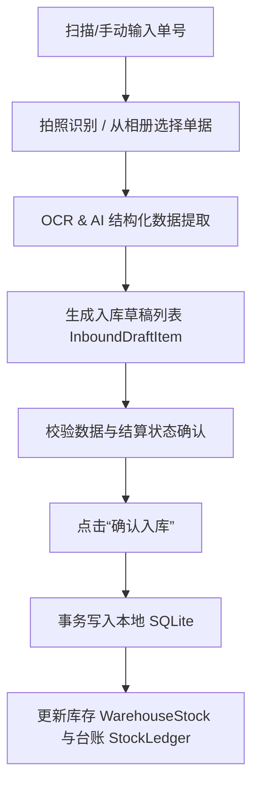

# 商品管理系统 - 移动端入库与数据备份说明文档

本篇文档旨在为您详细梳理本系统中**移动端入库功能**和**数据备份与保存功能**的设计原理、技术方案、数据库流动机制以及具体操作说明。

---

## 📥 一、入库功能详解 (Inbound Module)

移动端的入库设计采用“**离线优先、智能识别、双向事务同步**”的原则，特别为网络不佳或无网的仓库环境进行了深度优化。

### 1. 业务流程与数据流动
入库任务的流转过程如下：

* **入库核心字段**：
  * **快递单号 (`tracking_number`)**：全局唯一（受唯一性约束，已录入的会拦截防重）。
  * **订单号 (`seller_order_number`)** 和 **方案编号/返利单号 (`rebate_order_number`)**：辅助关联字段。
  * **结算状态 (`is_settled`)**：标记单据是否已完成财务对账结算。
  * **OCR 状态 (`ocr_status`)**：可选 `pending` (待处理), `processing` (识别中), `confirmed` (已确认), `failed` (失败)。

### 2. 智能 OCR 与 AI 提取机制
为提升仓库录单效率，系统支持调用移动端摄像头或相册，智能提取入库清单中的商品名、规格和数量：
* **行合并容差配置 (`ocr_row_merge_tolerance`)**：
  * 用户可在「我的」-「OCR 与 AI 配置」中调整 OCR 行距合并敏感度（支持 0.01 到 1.0 的严格-宽松范围）。
  * 较小的容差适用于表格线极其紧密的版面，防止行错位；较大的容差适用于手写或跨距较大的送货单，便于物理行合并。
* **双模提取引擎**：
  * **本地/自建离线 OCR 引擎**：支持通过 `PaddleOcrChannel` 在本机离线直接提取文字块，保障基础隐私与无网运行。
  * **云端大模型提取 (Gemini / OpenAI API)**：利用自建的大语言模型接口对 OCR 文本进行结构化分析，能够自动适配非规范化的商品名称，自动归类和提取进货价、销售价及数量，并回填至入库草稿列表中。

### 3. 数据写入与原子事务保证
当用户确认入库时，[`LocalInventoryDatabase.confirmInbound`](file:///Users/xcy/Project/%E5%95%86%E5%93%81%E7%AE%A1%E7%90%86%E7%B3%BB%E7%BB%9F/mobile_app/lib/src/data/local_inventory_database.dart#L616) 方法会在 SQLite 中开启原子事务（`txn`）：
1. **主表入库记录**：插入 `inbound_receipts` 表。
2. **生成并插入明细**：为每个商品明细生成 `$receiptId-item-$index` 并插入 `inbound_items`。
3. **安全创建商品**：若商品编码在 `products` 中不存在，则自动补全录入。
4. **递增物理库存**：在 `warehouse_stock` 表中累加对应商品的 `quantity`。
5. **记录库存变更流水**：向 `stock_ledger` 写入变更日志（`delta = +quantity`，关联原入库单 UUID），作为未来的审计跟踪和级联回退依据。
* **异常回滚**：如果写入期间任何一步失败（例如快递单号重复触发唯一约束，或数据格式异常），整个事务会**全部自动回滚**，避免数据损坏或“库存对不上账”的情况。

---

## 💾 二、数据备份与保存功能详解 (Backup & Data Management)

数据管理模块主要为了保证本地离线数据的安全性，并为手机存储空间瘦身。所有逻辑集成在「我的」-「[数据管理](file:///Users/xcy/Project/%E5%95%86%E5%93%81%E7%AE%A1%E7%90%86%E7%B3%BB%E7%BB%9F/mobile_app/lib/src/ui/data_management_page.dart)」页面中。

### 1. 导出备份 (Database Export)
本系统采用**单文件聚合备份**方案。当用户点击“导出备份”时：
* **数据流打包**：系统会自动遍历并读取所有核心业务表（`products`、`inbound_receipts`、`inbound_items`、`outbound_orders` 等），将其转换为统一的 JSON 数据包。
* **物理图片封包**：为了保证备份的完整性，导出会自动扫描入库单和出库附件关联的所有物理照片（物理路径存放在 `inbound_receipts.image_path` 和 `outbound_attachments.image_path`）。系统读取这些图片文件的二进制流，将其转换为 **Base64 编码**，统一封入备份的 JSON 字符串中。
* **文件存储位置**：
  * 移动端会在 App 专属的内部存储区 `getApplicationDocumentsDirectory()/backups/` 下，根据当前时间戳命名生成一个本地还原点文件（如 `inventory_backup_2026-06-14T20-13-52.json`）。
  * 如果是 Android 系统，系统还会利用原生通道同时向公共的 **`Download/` 目录** 导出一份，方便用户连接电脑进行跨设备备份或将文件提取出来。

### 2. 导入与覆盖还原 (Database Import)
* **文件检索**：支持调用系统文件选择器（File Picker），选择任意以 `.json` 结尾的备份包，或者在本地备份历史列表中一键选择还原点。
* **安全检验机制**：
  * **格式与版本锁**：导入时会强校验文件头部标识（需为格式 `inventory_mobile_app_backup`，版本与本地 schema 兼容）。
  * **安全模糊对话框**：在执行恢复前，系统调用高模糊（Blur）背景的危险对话框进行阻断警示，防止用户误触覆盖正在运行 of 业务数据。
* **事务性覆盖逻辑**：
  * 在数据库事务内首先**清空所有旧的表格数据**（包括库存、单据明细、配置参数等）。
  * 从 JSON 中解析出 Base64 编码的图片，在本地物理存储上还原恢复其原图文件并自动纠正物理路径映射。
  * 将打包的数据按照拓扑关系全部重新插入数据库。若其中任何解包和恢复动作报错，数据库将毫秒级回滚到导入前的完整状态，确保 App 绝对不会处于残缺数据状态。

### 3. 数据清理与存储释放
针对移动端随着时间推移产生大量图片垃圾、数据臃肿导致手机卡顿的问题，系统提供了三个维度的瘦身功能：
1. **压缩历史大图**：
   * 系统支持一键检测 7 天前的历史大图，采用图片压缩算法（基于 `image` 包进行二次降采样和质量压缩）对其物理文件进行缩减，既保留了单据原图作为审计凭证，又极大释放了手机存储。
2. **清理已结算文本数据**：
   * 物理清除数据库中所有已标记为“已结算”（`is_settled = 1`）的入库明细、历史出货单据及财务流水。
3. **清理已结算物理图片**：
   * 自动追踪那些已经结清的单据所关联的物理原图，进行永久物理删除。可以与文本清理独立使用。
